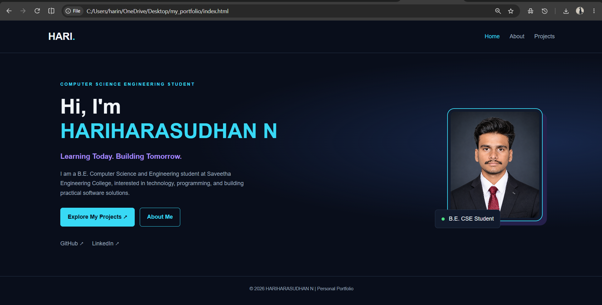
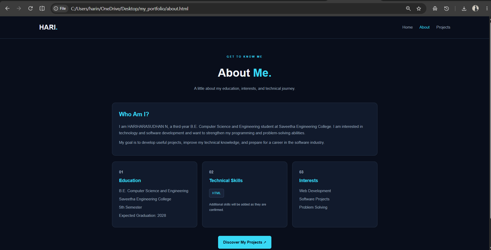
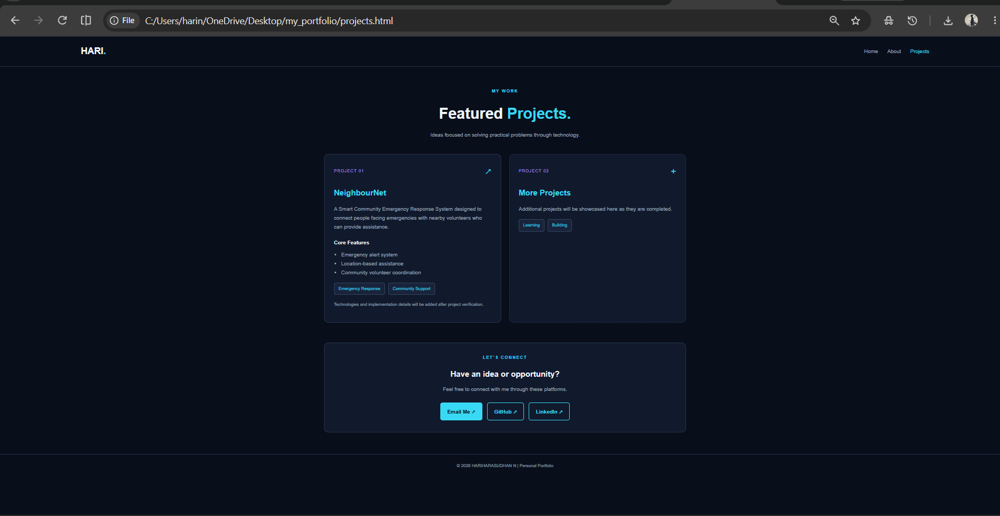

# Ex01 Portfolio
## Date:

## AIM
To create a Portfolio using HTML and CSS.

## ALGORITHM
### STEP 1
Create an HTML file (index.html)

### STEP 2
Create a CSS file (style.css)

### STEP 3
Include a navigation bar with links to different sections.

### STEP 4
Add structured sections for introduction, about, projects, and contact details.

### STEP 5
Define global styles for fonts, colors, and layout.

### STEP 6
Style the header, navigation bar, and sections.

### STEP 7
Use Flexbox or CSS Grid for layout design.

### STEP 8
Add hover effects and transitions for interactivity.

### STEP 9
Add Images and Media.

### STEP 10
Use optimized images for a professional look.

### STEP 11
Open the HTML file in a browser to check layout and functionality.

### STEP 12
Fix styling issues and refine content placement.

### STEP 13
Deploy the Portfolio.

### STEP 14
Upload to GitHub Pages for free hosting.

## PROGRAM
HTML

index.html
```
<!DOCTYPE html>
<html lang="en">
<head>
    <meta charset="UTF-8">
    <meta name="viewport" content="width=device-width, initial-scale=1.0">
    <title>Hari | Home</title>
    <link rel="stylesheet" href="style.css">
</head>
<body>

    <nav class="navbar">
        <a href="index.html" class="logo">HARI<span>.</span></a>

        <div class="nav-links">
            <a href="index.html" class="active">Home</a>
            <a href="about.html">About</a>
            <a href="projects.html">Projects</a>
        </div>
    </nav>

    <main class="hero">
        <div class="hero-content">
            <p class="tag">COMPUTER SCIENCE ENGINEERING STUDENT</p>

            <h1>Hi, I'm<br><span>HARIHARASUDHAN N</span></h1>

            <h2>Learning Today. Building Tomorrow.</h2>

            <p class="description">
                I am a B.E. Computer Science and Engineering student
                at Saveetha Engineering College, interested in technology,
                programming, and building practical software solutions.
            </p>

            <div class="buttons">
                <a href="projects.html" class="btn">Explore My Projects ↗</a>
                <a href="about.html" class="btn secondary">About Me</a>
            </div>

            <div class="social-links">
                <a href="https://github.com/HARI5865" target="_blank"
                   rel="noopener noreferrer">GitHub ↗</a>

                <a href="https://www.linkedin.com/in/hari-nallathambi-22729832a/"
                   target="_blank" rel="noopener noreferrer">LinkedIn ↗</a>
            </div>
        </div>

        <div class="hero-image">
            <div class="image-frame">
                
            </div>

            <div class="floating-card">
                <span class="status-dot"></span>
                B.E. CSE Student
            </div>
        </div>
    </main>

    <footer>
        <p>© 2026 HARIHARASUDHAN N | Personal Portfolio</p>
    </footer>

</body>
</html>
```
About.html
```
<!DOCTYPE html>
<html lang="en">
<head>
    <meta charset="UTF-8">
    <meta name="viewport" content="width=device-width, initial-scale=1.0">
    <title>Hari | About</title>
    <link rel="stylesheet" href="style.css">
</head>
<body>

    <nav class="navbar">
        <a href="index.html" class="logo">HARI<span>.</span></a>

        <div class="nav-links">
            <a href="index.html">Home</a>
            <a href="about.html" class="active">About</a>
            <a href="projects.html">Projects</a>
        </div>
    </nav>

    <main class="page-container">

        <section class="page-heading">
            <p class="tag">GET TO KNOW ME</p>
            <h1>About <span>Me.</span></h1>
            <p>A little about my education, interests, and technical journey.</p>
        </section>

        <section class="about-card">
            <h2>Who Am I?</h2>

            <p>
                I am HARIHARASUDHAN N, a third-year B.E. Computer Science
                and Engineering student at Saveetha Engineering College.
                I am interested in technology and software development
                and want to strengthen my programming and problem-solving
                abilities.
            </p>

            <p>
                My goal is to develop useful projects, improve my technical
                knowledge, and prepare for a career in the software industry.
            </p>
        </section>

        <section class="details-grid">
            <div class="info-card">
                <p class="card-number">01</p>
                <h3>Education</h3>
                <p>B.E. Computer Science and Engineering</p>
                <p>Saveetha Engineering College</p>
                <p>5th Semester</p>
                <p>Expected Graduation: 2028</p>
            </div>

            <div class="info-card">
                <p class="card-number">02</p>
                <h3>Technical Skills</h3>
                <div class="skill-list">
                    <span>HTML</span>
                </div>
                <p class="muted">
                    Additional skills will be added as they are confirmed.
                </p>
            </div>

            <div class="info-card">
                <p class="card-number">03</p>
                <h3>Interests</h3>
                <p>Web Development</p>
                <p>Software Projects</p>
                <p>Problem Solving</p>
            </div>
        </section>

        <div class="center">
            <a href="projects.html" class="btn">Discover My Projects ↗</a>
        </div>

    </main>

    <footer>
        <p>© 2026 HARIHARASUDHAN N | Personal Portfolio</p>
    </footer>

</body>
</html>
```
project.html
```

<!DOCTYPE html>
<html lang="en">
<head>
    <meta charset="UTF-8">
    <meta name="viewport" content="width=device-width, initial-scale=1.0">
    <title>Hari | Projects</title>
    <link rel="stylesheet" href="style.css">
</head>
<body>

    <nav class="navbar">
        <a href="index.html" class="logo">HARI<span>.</span></a>

        <div class="nav-links">
            <a href="index.html">Home</a>
            <a href="about.html">About</a>
            <a href="projects.html" class="active">Projects</a>
        </div>
    </nav>

    <main class="page-container">

        <section class="page-heading">
            <p class="tag">MY WORK</p>
            <h1>Featured <span>Projects.</span></h1>
            <p>Ideas focused on solving practical problems through technology.</p>
        </section>

        <section class="project-grid">

            <article class="project-card">
                <div class="project-top">
                    <span class="project-label">PROJECT 01</span>
                    <span class="project-symbol">↗</span>
                </div>

                <h2>NeighbourNet</h2>

                <p>
                    A Smart Community Emergency Response System designed
                    to connect people facing emergencies with nearby
                    volunteers who can provide assistance.
                </p>

                <h3>Core Features</h3>

                <ul>
                    <li>Emergency alert system</li>
                    <li>Location-based assistance</li>
                    <li>Community volunteer coordination</li>
                </ul>

                <div class="skill-list">
                    <span>Emergency Response</span>
                    <span>Community Support</span>
                </div>

                <p class="muted">
                    Technologies and implementation details will be added
                    after project verification.
                </p>
            </article>

            <article class="project-card upcoming">
                <div class="project-top">
                    <span class="project-label">PROJECT 02</span>
                    <span class="project-symbol">+</span>
                </div>

                <h2>More Projects</h2>

                <p>
                    Additional projects will be showcased here as they
                    are completed.
                </p>

                <div class="skill-list">
                    <span>Learning</span>
                    <span>Building</span>
                </div>
            </article>

        </section>

        <section class="contact-section">
            <p class="tag">LET'S CONNECT</p>
            <h2>Have an idea or opportunity?</h2>
            <p>Feel free to connect with me through these platforms.</p>

            <div class="buttons">
                <a href="mailto:harinallathambi381@gmail.com" class="btn">
                    Email Me ↗
                </a>

                <a href="https://github.com/HARI5865"
                   target="_blank" rel="noopener noreferrer"
                   class="btn secondary">
                    GitHub ↗
                </a>

                <a href="https://www.linkedin.com/in/hari-nallathambi-22729832a/"
                   target="_blank" rel="noopener noreferrer"
                   class="btn secondary">
                    LinkedIn ↗
                </a>
            </div>
        </section>

    </main>

    <footer>
        <p>© 2026 HARIHARASUDHAN N | Personal Portfolio</p>
    </footer>

</body>
</html>
```
style.css
```
* {
    margin: 0;
    padding: 0;
    box-sizing: border-box;
    scroll-behavior: smooth;
}

:root {
    --background: #090e1b;
    --card: #111a2c;
    --accent: #38d9f5;
    --purple: #a78bfa;
    --text: #f1f5f9;
    --muted: #9ca9bd;
    --border: #263449;
}

body {
    font-family: Arial, sans-serif;
    background: var(--background);
    color: var(--text);
    line-height: 1.7;
}

.navbar {
    display: flex;
    justify-content: space-between;
    align-items: center;
    padding: 22px 8%;
    border-bottom: 1px solid var(--border);
}

.logo {
    font-size: 28px;
    font-weight: bold;
    color: var(--text);
    text-decoration: none;
}

.logo span,
.hero h1 span,
.page-heading h1 span {
    color: var(--accent);
}

.nav-links {
    display: flex;
    gap: 28px;
}

.nav-links a {
    color: var(--muted);
    text-decoration: none;
    transition: color 0.3s;
}

.nav-links a:hover,
.nav-links a.active {
    color: var(--accent);
}

.hero {
    min-height: 78vh;
    display: flex;
    justify-content: space-between;
    align-items: center;
    gap: 60px;
    padding: 70px 10%;
    background:
        radial-gradient(ellipse at 90% 40%, #17274a 0%, transparent 45%);
}

.hero-content {
    max-width: 650px;
}

.tag {
    color: var(--accent);
    font-size: 12px;
    font-weight: bold;
    letter-spacing: 3px;
    margin-bottom: 18px;
}

.hero h1 {
    font-size: clamp(34px, 5vw, 58px);
    line-height: 1.2;
    margin-bottom: 20px;
}

.hero h2 {
    font-size: 20px;
    color: var(--purple);
    margin-bottom: 18px;
}

.description {
    color: var(--muted);
    max-width: 550px;
}

.buttons {
    display: flex;
    flex-wrap: wrap;
    gap: 14px;
    margin-top: 28px;
}

.btn {
    display: inline-block;
    padding: 12px 20px;
    border: 1px solid var(--accent);
    border-radius: 7px;
    background: var(--accent);
    color: #07111f;
    font-weight: bold;
    text-decoration: none;
    transition: transform 0.3s, background 0.3s;
}

.btn:hover {
    transform: translateY(-4px);
    background: #7ceaff;
}

.btn.secondary {
    background: transparent;
    color: var(--accent);
}

.btn.secondary:hover {
    background: #14253a;
}

.hero-image {
    position: relative;
    flex-shrink: 0;
}

.image-frame {
    width: 270px;
    height: 320px;
    padding: 8px;
    border: 2px solid var(--accent);
    border-radius: 20px;
    background: var(--card);
    box-shadow: 12px 12px 0 #25204b;
}

.image-frame img {
    width: 100%;
    height: 100%;
    object-fit: cover;
    border-radius: 13px;
}

.floating-card {
    position: absolute;
    bottom: -20px;
    left: -35px;
    padding: 12px 18px;
    border: 1px solid var(--border);
    border-radius: 8px;
    background: var(--card);
}

.status-dot {
    display: inline-block;
    width: 9px;
    height: 9px;
    border-radius: 50%;
    background: #4ade80;
    margin-right: 7px;
}

.social-links {
    display: flex;
    gap: 24px;
    margin-top: 35px;
}

.social-links a {
    color: var(--muted);
    text-decoration: none;
    transition: color 0.3s;
}

.social-links a:hover {
    color: var(--accent);
}

.page-container {
    width: 84%;
    max-width: 1100px;
    margin: auto;
    padding: 65px 0;
}

.page-heading {
    text-align: center;
    margin-bottom: 45px;
}

.page-heading h1 {
    font-size: clamp(32px, 5vw, 46px);
    margin-bottom: 12px;
}

.page-heading > p:last-child {
    color: var(--muted);
}

.about-card,
.info-card,
.project-card {
    padding: 28px;
    border: 1px solid var(--border);
    border-radius: 14px;
    background: var(--card);
    transition: transform 0.3s, border-color 0.3s;
}

.about-card {
    margin-bottom: 25px;
}

.about-card h2 {
    color: var(--accent);
    margin-bottom: 15px;
}

.about-card p {
    color: var(--muted);
    margin-bottom: 12px;
}

.details-grid {
    display: grid;
    grid-template-columns: repeat(3, minmax(0, 1fr));
    gap: 20px;
}

.info-card:hover,
.project-card:hover {
    transform: translateY(-6px);
    border-color: var(--accent);
}

.card-number {
    color: var(--purple);
    font-weight: bold;
    margin-bottom: 12px;
}

.info-card h3 {
    color: var(--accent);
    margin-bottom: 12px;
}

.info-card p {
    color: var(--muted);
    margin-bottom: 7px;
}

.skill-list {
    display: flex;
    flex-wrap: wrap;
    gap: 10px;
    margin: 18px 0;
}

.skill-list span {
    padding: 6px 12px;
    border: 1px solid #33445f;
    border-radius: 6px;
    background: #19243a;
    color: var(--accent);
    font-size: 13px;
}

.muted {
    color: var(--muted);
    font-size: 13px;
}

.center {
    text-align: center;
    margin-top: 35px;
}

.project-grid {
    display: grid;
    grid-template-columns: repeat(2, minmax(0, 1fr));
    gap: 24px;
}

.project-top {
    display: flex;
    justify-content: space-between;
    align-items: center;
    margin-bottom: 20px;
}

.project-label {
    color: var(--purple);
    font-size: 12px;
    letter-spacing: 2px;
}

.project-symbol {
    color: var(--accent);
    font-size: 28px;
}

.project-card h2 {
    color: var(--accent);
    margin-bottom: 15px;
}

.project-card p {
    color: var(--muted);
    margin-bottom: 15px;
}

.project-card h3 {
    margin-top: 20px;
    font-size: 16px;
}

.project-card ul {
    padding-left: 22px;
    color: var(--muted);
    margin-top: 10px;
}

.upcoming {
    border-style: dashed;
}

.contact-section {
    margin-top: 60px;
    padding: 35px;
    text-align: center;
    border: 1px solid var(--border);
    border-radius: 14px;
    background: var(--card);
}

.contact-section h2 {
    margin-bottom: 12px;
}

.contact-section > p:not(.tag) {
    color: var(--muted);
}

.contact-section .buttons {
    justify-content: center;
}

footer {
    padding: 24px;
    border-top: 1px solid var(--border);
    text-align: center;
    color: var(--muted);
    font-size: 13px;
}

@media (max-width: 800px) {
    .hero {
        flex-direction: column-reverse;
        text-align: center;
        padding: 55px 7%;
    }

    .hero-content {
        width: 100%;
    }

    .hero-image {
        margin-bottom: 20px;
    }

    .buttons,
    .social-links {
        justify-content: center;
    }

    .details-grid {
        grid-template-columns: repeat(2, minmax(0, 1fr));
    }

    .project-grid {
        grid-template-columns: 1fr;
    }
}

@media (max-width: 550px) {
    .navbar {
        flex-direction: column;
        gap: 15px;
    }

    .nav-links {
        justify-content: center;
        flex-wrap: wrap;
        gap: 12px 20px;
    }

    .hero h1 {
        font-size: 34px;
    }

    .image-frame {
        width: 220px;
        height: 260px;
    }

    .floating-card {
        left: -15px;
    }

    .page-container {
        width: 90%;
        padding: 45px 0;
    }

    .details-grid {
        grid-template-columns: 1fr;
    }

    .contact-section {
        padding: 25px 15px;
    }
}
```

## OUTPUT








## RESULT
The program for creating Portfolio using HTML and CSS is executed successfully.
